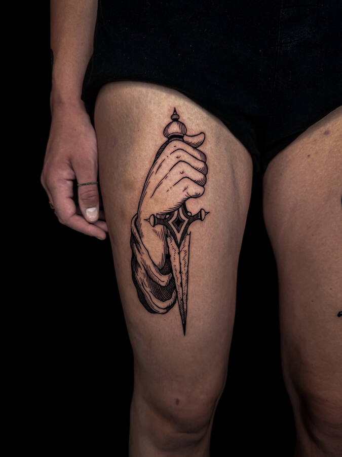

# Maxime — tatoueur

Site de Maxime, tatoueur en Suisse romande. Pages statiques, sans framework ni étape de build : on dépose le dossier tel quel chez l'hébergeur.

## Pages

| Fichier | Contenu |
| --- | --- |
| `index.html` | Accueil : le nom qui sort du flou sur le fond animé, manifeste, quatre pièces portées, les flashs de la saison, du carnet à la peau en quatre temps, le studio |
| `flashs.html` | Onglets « Disponibles » (chaque dessin en grand avec ses mesures, ordre tiré au sort) et « Déjà tatoués » (le dessin se retourne sur la peau), saisons passées, réserver |
| `tatouages.html` | Quatre dessins de Maxime, posés sans cadre sur la gravure ; on en choisit un et seul ce thème s'affiche : croquis et peau, films, autres pièces, visionneuse plein écran |
| `processus.html` | Le chemin d'un seul dessin : un cadre montre les quatre temps (carnet, encre, séance, après) et, pour chacun, des films, des croquis et les mots de Maxime |
| `rendez-vous.html` | Écrire, le message déjà écrit sur une carte où l'on choisit les mots soulignés (prêt pour l'e-mail ou Instagram), déroulement, studio, soins, questions |
| `404.html` | Page introuvable (chemins depuis la racine : `<base href="/">`) |

## Direction

- **Fond** : brume et gravure rouge sang en WebGL (`js/fond*.js`), derrière toutes les pages. La gravure affleure en permanence dans la brume et s'avive sous la lumière : elle suit la souris ; sur téléphone, rien ne suit le doigt, une lanterne se promène seule lentement (`js/fond-pointeur.js`) et reprend son trajet d'une page à l'autre. Pas de rayons. Quand le menu s'ouvre, la gravure remonte pleinement. D'une page à l'autre, la brume continue son chemin au lieu de repartir du noir.
- **Voile** : sur téléphone et tablette, un noir dense passe sous le texte et les images de chaque section (classe `voile`), fondu en haut et en bas ; la gravure reste entière entre les blocs, sur la couverture et dans le menu. Sur ordinateur, le fond reste libre.
- **Dessins** : les emblèmes blancs de Maxime (`em-*.webp`) ouvrent les thèmes de Tatouages, le menu et la page Rendez-vous ; les croquis au crayon rouge sont tirés sur papier crème (`cadre papier`). Aucune image n'est penchée ni décalée, sur téléphone comme sur ordinateur : les images d'une même rangée sont droites et alignées.
- **Typographie** : IM Fell English (romain, italique) et IM Fell English SC (petites capitales), licence OFL. Grands titres qui prennent toute la largeur, chiffres romains, filets fins, lettrine rouge. Pas de cases ni de blocs de chiffres encadrés : les dessins des thèmes sont posés à même la gravure, sur un halo d'ombre.
- **Menu** : table des matières plein écran (`<dialog>`). Un rideau noir descend et couvre la page avant que rien n'apparaisse (la page ne se voit jamais sous les chapitres), puis s'éclaircit sur la gravure ; les chapitres montent un à un, l'emblème blanc du chapitre apparaît (en haut sur téléphone, à droite sur ordinateur). La page en cours est marquée en rouge, d'un losange. À l'ouverture, le focus va au menu lui-même : aucun lien n'est encadré comme s'il était choisi. Le son est rangé dans le pied du menu, avec son nom (« Son coupé » / « Son allumé »).
- **Boutons** : à angles droits, cernés ; plein (fond clair) pour l'action principale.

## Téléphone d'abord

Chaque disposition est d'abord pensée pour le pouce, puis élargie ; rien n'est une version d'ordinateur rétrécie. Calibré de 320 à 430 px de large, debout et à l'horizontale.

- **Barre du haut** (téléphone et tablette) : le nom à gauche, Menu à droite, rien d'autre. Dans le menu, « Fermer » prend la place exacte de « Menu ».
- **Accueil** : la couverture tient dans l'écran, le nom posé en bas de l'écran, chaque lettre sort du flou. Pièces et flashs en grille de deux colonnes (quatre dès la tablette) ; le chemin du carnet à la peau en quatre images avec leur phrase, deux par deux au téléphone, en frise dès la tablette.
- **Grilles de pièces** (`pieces`) : deux colonnes au pouce, trois sur tablette, quatre sur ordinateur (ou `--colonnes`), toutes au format 3 / 4, la légende dessous. Plus de rangées à glisser.
- **Tatouages** : un thème à la fois (`js/themes.js`) ; l'adresse garde le thème (`tatouages.html#cranes`), le « retour » ramène au précédent puis aux quatre dessins. Les quatre emblèmes restent en onglets collés sous la barre, sur un noir plein qui passe sous son fondu : aucun jour entre les deux. Même chose pour les onglets des Flashs, deux gros boutons carrés (blanc plein sur celui qui est ouvert), collés seulement le temps du catalogue.
- **Processus** : un cadre unique (`js/processus.js`) ; on touche un temps, on glisse l'image, on touche les flèches posées sur l'image ou les touches ← →, la nouvelle se découvre de bas en haut ; seule la documentation de ce temps s'affiche (`processus.html#encre`).
- **Flashs** : onglets « Disponibles » / « Déjà tatoués » (`js/onglets.js`) ; un dessin tatoué se retourne sur la pièce portée (`js/retourne.js`). « Réserver ce dessin » ouvre le formulaire avec ce flash déjà choisi (`rendez-vous.html?flash=dague-et-roses#ecrire`).
- **Rendez-vous** (en-tête sobre comme les autres pages, sans dessin sur le côté ; sur ordinateur la carte est étroite et haute, posée à gauche, les boutons d'envoi à droite) : le message est déjà écrit sur une carte de papier (`js/composeur.js`) : papier crème au grain léger, double filet rouge, l'œil de Maxime imprimé à l'encre en tête. Les choix (flash ou projet, l'endroit, la taille) sont des champs encadrés de rouge, avec leur flèche, posés dans la phrase ; chacun cache un vrai sélecteur : le toucher ouvre la liste du téléphone. « ailleurs… » ouvre une ligne pour préciser l'endroit, un projet ouvre des lignes réglées pour l'idée, et les jours se cochent sur la carte (carrés pleins d'encre une fois cochés). Le message part par e-mail (sujet et texte déjà remplis) ou se copie pour Instagram.
- **Visionneuse** : l'œuvre grandit depuis sa vignette ; on glisse de l'une à l'autre, on la tire vers le bas pour la reposer, et elle retourne à sa place.
- **Retour du téléphone** : le bouton ou le geste « retour » referme le menu ou la visionneuse au lieu de quitter la page.
- **Animations** : courtes sur téléphone (on y fait défiler vite), aucune ne fait attendre le pouce. D'une page à l'autre, la barre du haut ne bouge pas. Zones tactiles de 44 px, marges de sécurité (encoche).
- **Tablette et ordinateur** : grille de 12 colonnes dès 768 px ; dès 1024 px, en-tête fixe à la place de la barre. Les images gardent la taille des pièces de l'accueil (un quart de la largeur) et la largeur est remplie sans case vide : sur Tatouages, le dessin et le titre à gauche, le texte à droite, puis croquis, peau et films par quatre (la phrase de Maxime prend la case d'un film absent, les boutons de thème celle d'une pièce absente) ; sur Processus, le cadre reste collé à gauche (c'est le seul élément collé) sur quatre colonnes à gauche et la documentation à droite, ses images par trois ; sur Flashs, deux planches côte à côte, chacune avec son dessin à gauche et son texte à droite ; sur Rendez-vous, la carte du message à droite des choix.

## Structure

```
├── index.html · flashs.html · tatouages.html · processus.html · rendez-vous.html · 404.html
├── favicon.ico · favicon.svg · apple-touch-icon.png · site.webmanifest · robots.txt
├── css/
│   ├── styles.css        point d'entrée, importe les autres
│   ├── reset.css
│   ├── base.css          polices, couleurs, liens, boutons, mouvement réduit
│   ├── fond.css          canevas du fond animé + repli fixe sans WebGL
│   ├── entete.css        en-tête (le nom seul sur téléphone, bandeau fixe sur ordinateur)
│   ├── barre.css         barre du haut (téléphone et tablette)
│   ├── menu.css          menu plein écran et ses animations
│   ├── mise-en-page.css  grille, sections, têtes de page, sommaires, révélations
│   ├── oeuvres.css       cadres, légendes, planches, tampon, pensées
│   ├── blocs.css         titre de bloc, croquis sur papier, du croquis à la peau, films, grilles de pièces
│   ├── accueil.css       ouverture, manifeste, grilles de pièces et de flashs, étapes du carnet à la peau, studio
│   ├── pages.css         registre des saisons, déroulé, canaux, soins, questions, 404
│   ├── tatouages.css     quatre dessins à choisir, onglets d'emblèmes, chapitres
│   ├── processus.css     cadre des quatre temps, documentation
│   ├── flashs.css        onglets, planches en grand, cartes qui se retournent
│   ├── rendez-vous.css   carte du message à compléter
│   ├── visionneuse.css   œuvres en grand
│   └── pied.css
├── js/
│   ├── main.js           point d'entrée (module)
│   ├── fond.js · fond-gl.js · fond-shader.js · fond-pointeur.js   le fond animé
│   ├── menu.js           ouverture et fermeture du menu (rideau), emblèmes
│   ├── couche.js         le « retour » du téléphone referme le menu ou la visionneuse
│   ├── entete.js         en-tête qui se retire (ordinateur), petit nom de l'accueil
│   ├── themes.js         Tatouages : un thème à la fois
│   ├── processus.js      Processus : le cadre des quatre temps
│   ├── onglets.js        Flashs : disponibles, déjà tatoués
│   ├── retourne.js       Flashs : le dessin tatoué se retourne sur la peau
│   ├── composeur.js      Rendez-vous : le message préparé, e-mail ou copie pour Instagram
│   ├── revele.js         apparition des images et des textes au défilement
│   ├── visionneuse.js    œuvres en grand : envol depuis la vignette, glisser, tirer vers le bas, flèches, Échap
│   ├── melange.js        ordre aléatoire des flashs disponibles
│   └── video.js          vidéos lues seules quand elles sont à l'écran, bouton « Pause »
├── assets/
│   ├── img/              photos (tt-), flashs (fl-), carnet (cn-), studio (st-), emblèmes (em-*.webp, fond transparent), icônes, image de partage
│   ├── video/            extraits MP4 de 9 s + image d'attente
│   └── fonts/            IM Fell English
└── tools/
    └── build-preview.py  version tout-en-un pour un hébergement de maquette
```

## Placer une œuvre

Dans une grille de pièces, une œuvre n'a pas de placement à choisir : la grille les aligne toutes au même format.

```html
<div class="pieces" data-visionneuse>
  <figure class="oeuvre" data-revele="image">
    <div class="cadre"></div>
    <figcaption class="legende"><span class="legende-titre">Main à la dague</span><span class="legende-lieu cap">Cuisse</span></figcaption>
  </figure>
</div>
```

- Deux colonnes sur téléphone, trois sur tablette, quatre sur ordinateur ; `--colonnes` (et `--colonnes-tablette`) en changent le nombre. Toutes les images en 3 / 4.
- Une pièce d'un thème de Tatouages se place dans la grille « Les autres pièces » de son chapitre ; une vidéo, dans son bloc « En mouvement » :

```html
<figure class="film">
  <div class="cadre"><video id="film-serpent" data-autoplay muted loop playsinline preload="none" poster="assets/video/v-serpent.jpg" aria-label="…"><source src="assets/video/v-serpent.mp4" type="video/mp4" /></video></div>
  <figcaption class="film-legende"><span class="film-titre">Serpent et main</span><button class="film-pause cap" type="button" data-pause aria-controls="film-serpent" hidden>Pause</button></figcaption>
</figure>
```

- `cadre papier` : un croquis sur sa feuille crème, droit, avec son ombre.
- Hors galerie (manifeste, studio, flashs), `--c` / `--h` placent un bloc sur 6 colonnes au téléphone, `--cd` / `--hd` sur 12 colonnes dès 768 px.
- `--r` sur le cadre : format hors galerie (`3 / 4` par défaut, `9 / 16`, `2 / 3`, `1 / 1`).
- `oeuvre--plein` : l'image touche les deux bords sur téléphone. `cadre--arche` : plein cintre.
- Dans un bloc `data-visionneuse`, chaque œuvre s'ouvre en grand ; la légende est reprise dans la visionneuse.
- Une vidéo : `<video data-autoplay muted loop playsinline preload="none" poster="…">` avec un `aria-label` ; elle se lance seule quand elle est à l'écran.

## Conventions

- Les vidéos sont muettes, en boucle, se lancent seules et ne tournent qu'à l'écran ; « Pause » sous un film l'arrête pour de bon. Mouvement réduit demandé : pas d'animation, vidéos à l'arrêt avec leurs commandes, fond en image fixe.
- Les révélations ne cachent que ce qui est sous l'écran au chargement ; sans script, tout est visible : les thèmes, les quatre temps et les deux parties des flashs se suivent, le formulaire laisse place à la liste de ce qu'il faut écrire.
- Le fond est plafonné (30 images/s, résolution limitée, pause quand l'onglet est caché). Sans WebGL, la gravure fixe s'affiche en CSS. Il faut servir le site en HTTP (la texture ne charge pas en `file://`).
- En-tête, barre du haut, menu et pied sont identiques sur toutes les pages : une modification se reporte dans chaque fichier HTML.

## Lancer en local

```
python3 -m http.server 8000
```

puis ouvrir `http://localhost:8000/`.

## À compléter avant la mise en ligne

- **Instagram et e-mail de Maxime** : les liens sont marqués `data-a-completer="instagram"` et `data-a-completer="e-mail"` (menu, pied de page, page Rendez-vous). Remplacer leur `href="#"` par l'adresse du compte et par `mailto:…`. Le bouton « Envoyer par e-mail » du message préparé reprend cette adresse tout seul ; tant qu'elle manque, la messagerie s'ouvre sans destinataire.
- **Adresse du site** : une fois le domaine connu, passer `og:image` en adresse absolue (`https://…/assets/img/partage.jpg`) pour les aperçus de partage.
- Contenus à relire avec Maxime : notes de la page Processus (écrites dans sa voix), tailles et emplacements des flashs, saisons passées, date de mise à jour du catalogue.
